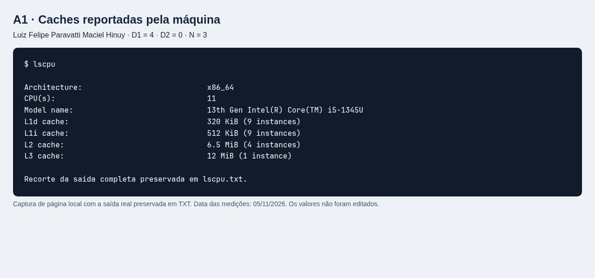
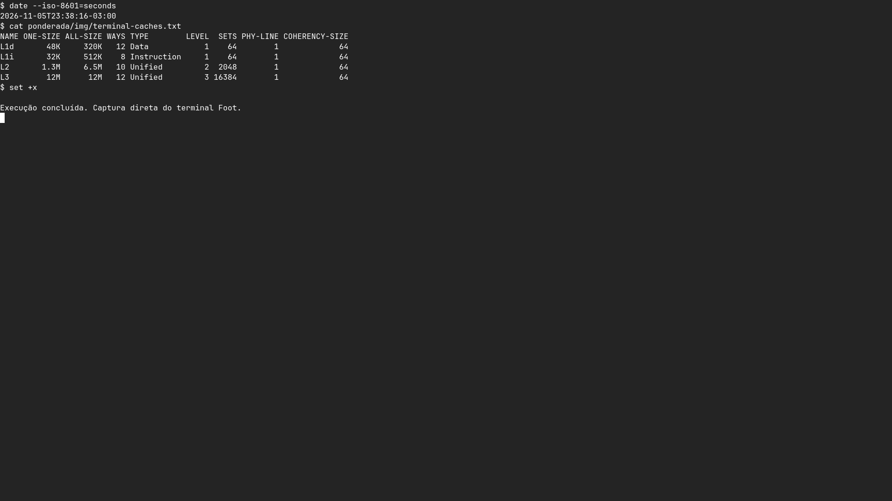
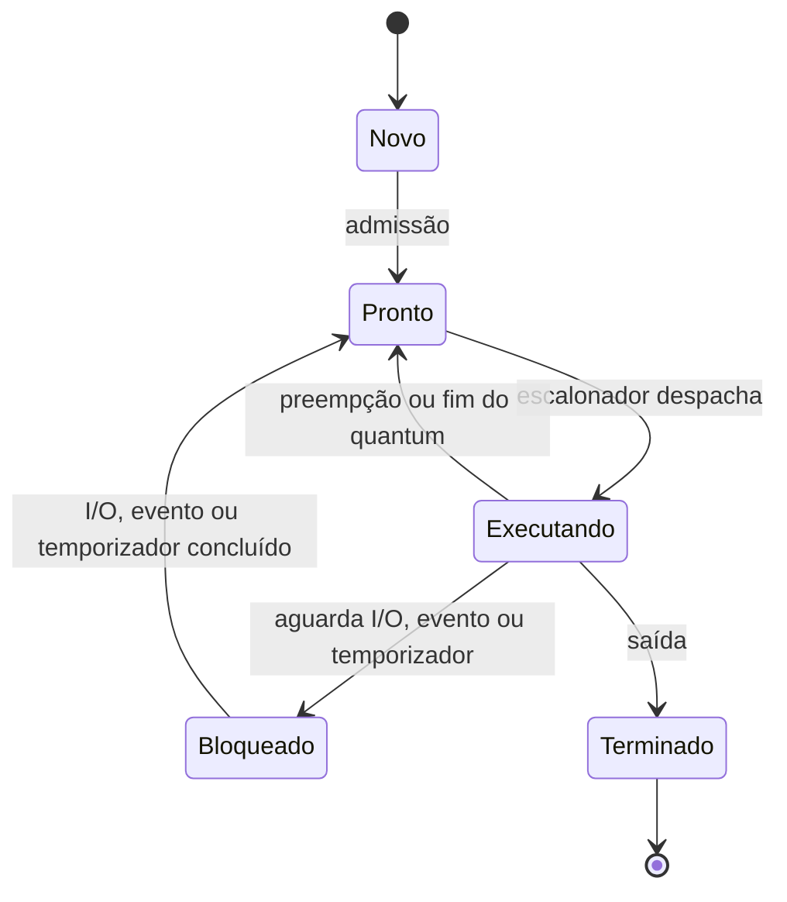
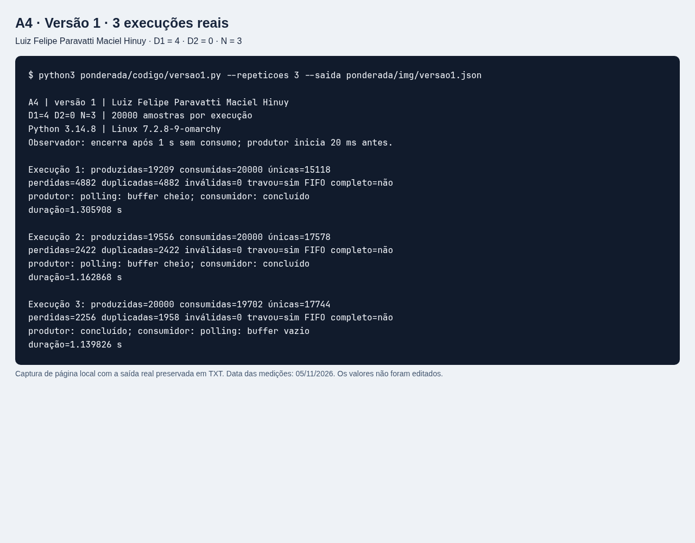
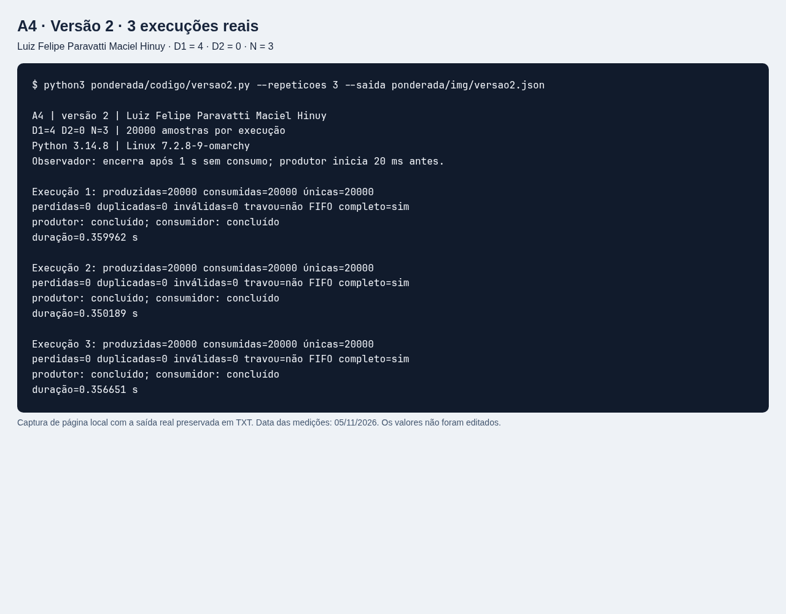
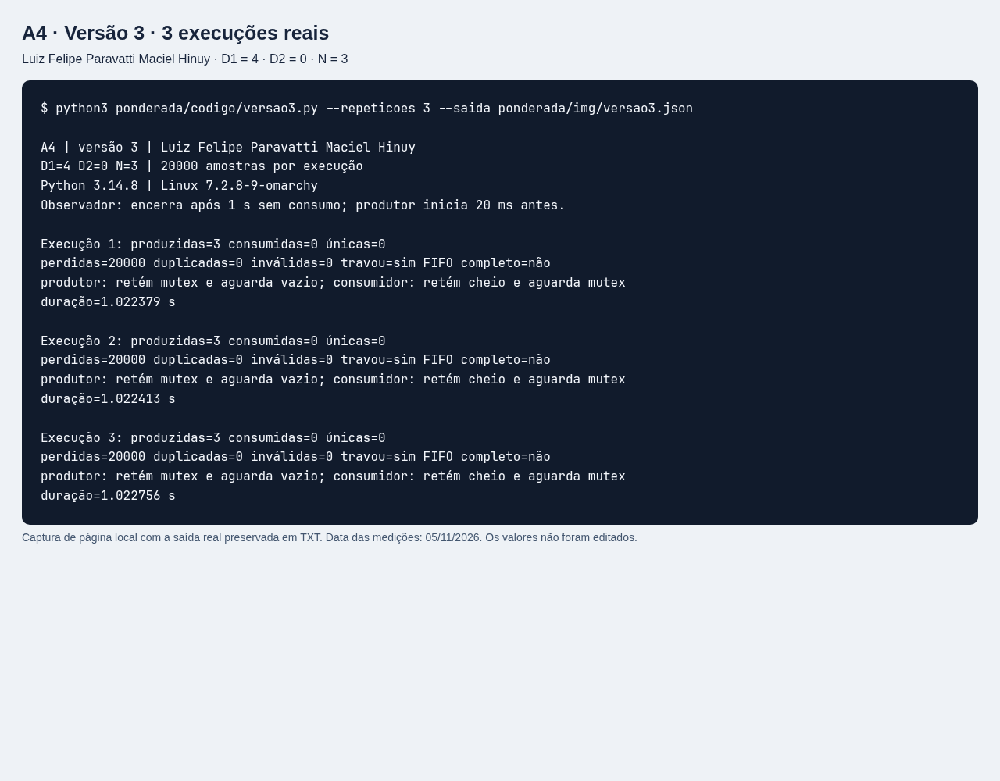
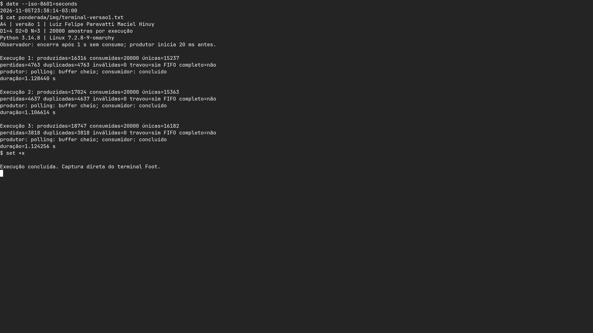
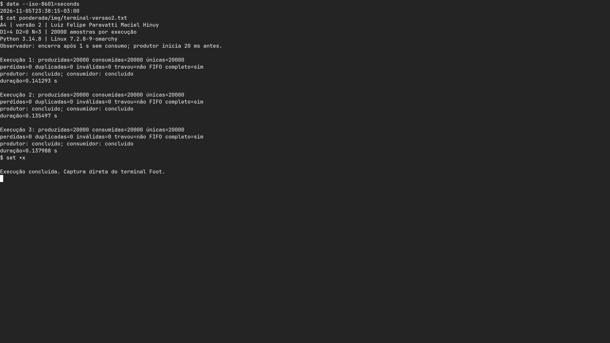
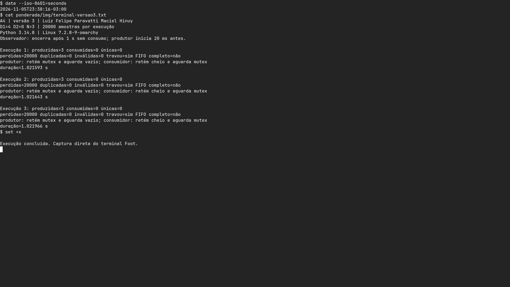
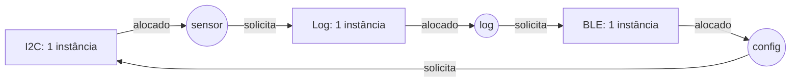

Luiz Felipe Paravatti Maciel Hinuy | D1 = 4 | D2 = 0 | N = 3

# Ponderada Computação CC08: do pipeline ao deadlock

## Parâmetros individuais e premissas

Conto somente letras: **Luiz (4) + Felipe (6) + Paravatti (9) + Maciel (6)
+ Hinuy (5) = 30**. Portanto:

- D1 = 4;
- D2 = 30 mod 10 = 0;
- IC = 100.000 + 20.000 × 0 = **100.000 instruções/amostra**;
- m = 3% + 0,5% × 4 = **5% = 0,05**;
- N = 3 + (0 mod 5) = **3 posições**.

A pulseira amostra a 100 Hz: período = 1/100 s = **10 ms**. O prazo de
processamento continua sendo **5 ms por amostra**; não posso usar os 10 ms como
limite. As contas abaixo usam o modelo fornecido no enunciado.

# Parte A: o problema técnico

## A1. Arquitetura e memória

### 1. Plataforma H

A relação entre instruções, CPI e clock é:

```text
T = IC × CPI / frequência
T_H = 100.000 × 1,5 / (48 × 10^6)
    = 150.000 / 48.000.000 s
    = 0,003125 s = 3,125 ms
Margem = 5 - 3,125 = 1,875 ms
```

**H atende aos 5 ms sem DSP**, segundo o modelo. O processamento ocupa
3,125/10 = **31,25% do período de amostragem**, antes das demais tarefas.

### 2. Plataforma V

Adoto os 120 ciclos como **penalidade adicional de falta**, coerentemente com a
fórmula de CPI exigida no enunciado. Assim, uma falta inclui o ciclo da consulta
à L1 e os 120 ciclos de penalidade.

```text
AMAT = tempo de acerto + m × penalidade
     = 1 + 0,05 × 120 = 7 ciclos por acesso
Período de clock = 1 / (1,2 × 10^9) s = 0,833333 ns
AMAT = 7 × 0,833333 = 5,833333 ns

CPI_efetivo = 1,0 + acessos/instrução × m × penalidade
            = 1 + 1,3 × 0,05 × 120
            = 1 + 7,8 = 8,8 ciclos/instrução

T_V = 100.000 × 8,8 / (1,2 × 10^9)
    = 880.000 / 1.200.000.000 s
    = 0,733333 ms
T_V com atraso máximo de SO = 0,733333 + 3 = 3,733333 ms
Margem = 5 - 3,733333 = 1,266667 ms
```

**V também atende no cálculo solicitado**, inclusive com os 3 ms adicionais.
O CPI base já contabiliza o funcionamento sem faltas: somo somente as paradas,
sem multiplicar novamente todo o AMAT por 1,3 e contar os acertos duas vezes.

Esse “pior caso” é o tempo calculado com a **taxa média de faltas**, acrescido
do maior atraso de SO informado. Não é uma prova de WCET: a taxa m não limita
as faltas de cada amostra, e o enunciado não fornece limites para todas as
fontes de interferência. Em produção, preciso medir e limitar o caminho completo.

### 3. H com DSP: Lei de Amdahl

Somente o filtro, que ocupa 60% do tempo original, recebe aceleração de 5 vezes.

```text
S_global = 1 / [(1 - 0,60) + 0,60/5]
         = 1 / (0,40 + 0,12)
         = 1/0,52 = 1,923077 vezes
T_novo = 3,125 / 1,923077 = 3,125 × 0,52 = 1,625 ms

Conferência por parcelas:
Parte não acelerada = 3,125 × 0,40 = 1,250 ms
Filtro acelerado = (3,125 × 0,60)/5 = 0,375 ms
Total = 1,250 + 0,375 = 1,625 ms
```

**H com DSP atende**, com margem de 5 - 1,625 = **3,375 ms**. Para meus
parâmetros, porém, o DSP não é necessário para satisfazer a conta de A1.

| Plataforma | Processamento | Com atraso de SO informado | Atende a 5 ms no modelo? |
| --- | ---: | ---: | --- |
| H | 3,125 ms | 3,125 ms | Sim |
| V | 0,733333 ms | 3,733333 ms | Sim |
| H + DSP | 1,625 ms | 1,625 ms | Sim |

### 4. Cache e gargalo de Von Neumann (quatro linhas)

V opera a 1,2 GHz, mas acessar a DRAM externa custa muitos ciclos.<br>
Instruções e dados disputam o caminho para a memória, o gargalo de Von Neumann.<br>
A cache reduz acessos externos explorando localidade e mantém o processador alimentado.<br>
H usa SRAM de um ciclo e caminhos Harvard separados, dispensando cache neste modelo.

### 5. Evidência da máquina

Saída real do comando `lscpu`, coletada em 05/11/2026 no ambiente desta atividade:
[texto completo](img/lscpu.txt).



**Complemento da revisão:** captura direta do terminal Foot, exibindo a saída
preservada de `lscpu --caches`, sem substituir o print anterior:
[saída textual de caches](img/terminal-caches.txt).



O ambiente reporta **Intel Core i5-1345U**, L1d = **320 KiB (9 instâncias)**,
L1i = **512 KiB (9 instâncias)**, L2 = **6,5 MiB (4 instâncias)** e L3 =
**12 MiB (1 instância)**. Esses valores são os totais expostos pelo `lscpu`,
não tamanhos por núcleo; não infiro a topologia física apenas desses totais.

A L1 está dividida em instruções e dados. Isso caracteriza **Harvard modificada
na hierarquia próxima do núcleo**, enquanto o modelo de programação x86 mantém
memória unificada para código e dados, de **Von Neumann**. Ter caches L1 separadas
não transforma o computador inteiro em uma Harvard pura com espaços de memória
independentes.

## A2. Pipeline: o loop do filtro

Identifico as instruções originais por I1 a I7:

```asm
I1: lw   x5, 0(x10)
I2: add  x6, x6, x5
I3: lw   x7, 0(x11)
I4: sub  x6, x6, x7
I5: sw   x6, 0(x12)
I6: addi x10, x10, 4
I7: addi x11, x11, 4
```

### 1. Dependências RAW

| Produtor → consumidor | Registrador | Valor necessário |
| --- | --- | --- |
| I1 → I2 | x5 | Amostra nova carregada |
| I2 → I4 | x6 | Soma após adicionar a nova |
| I3 → I4 | x7 | Amostra antiga carregada |
| I4 → I5 | x6 | Soma final a gravar |

I2 → I5 é uma relação transitiva, mas não uma RAW direta: I4 redefine x6.
I6 e I7 usam os valores anteriores dos ponteiros e não têm produtores anteriores
desses registradores dentro do trecho. Existem restrições WAR I1 → I6 em x10
e I3 → I7 em x11: ao reordenar, não posso avançar o ponteiro antes do seu `lw`.
I2 e I4 também escrevem x6 (WAW); a ordem dessas duas operações deve ser mantida.

### Premissas dos diagramas

Pipeline em ordem, emissão de uma instrução por ciclo, memórias de instruções e
dados capazes de evitar conflito estrutural, sem falta de cache ou desvio.
`ID*` e `IF*` representam a instrução retida por stall; as posições vazias em EX
nesses ciclos são bolhas. WB escreve na primeira metade do ciclo e ID lê na
segunda, permitindo leitura no mesmo ciclo de WB. O `sw` usa MEM para escrever
e não altera registrador em WB; mostro `WB-` para conservar os cinco estágios
e o critério de contagem pedido.

### 2. Sem forwarding

```text
Ciclo  01  02  03  04  05  06  07  08  09  10  11  12  13  14  15  16  17
I1     IF  ID  EX MEM  WB
I2         IF  ID ID* ID*  EX MEM  WB
I3             IF IF* IF*  ID  EX MEM  WB
I4                         IF  ID ID* ID*  EX MEM  WB
I5                             IF IF* IF*  ID ID* ID*  EX MEM WB-
I6                                         IF IF* IF*  ID  EX MEM  WB
I7                                                     IF  ID  EX MEM  WB
```

I2 aguarda o WB de I1 no ciclo 5: **2 bolhas**. I4 aguarda x6 (WB de I2 no
ciclo 8) e x7 (WB de I3 no ciclo 9): **2 bolhas**, com a leitura conjunta no
ciclo 9. I5 aguarda o WB de I4 no ciclo 12: **2 bolhas**. O congelamento de
IF durante um stall impede as instruções seguintes de ultrapassarem a parada.

```text
Ciclos ideais = instruções + estágios - 1 = 7 + 5 - 1 = 11
Ciclos reais = 11 + 2 + 2 + 2 = 17 ciclos
```

### 3. Com forwarding

Considero forwarding completo: EX/MEM e MEM/WB para as entradas de EX e caminho
de encaminhamento do dado a ser gravado pelo `sw`.

```text
Ciclo  01  02  03  04  05  06  07  08  09  10  11  12  13
I1     IF  ID  EX MEM  WB
I2         IF  ID ID*  EX MEM  WB
I3             IF IF*  ID  EX MEM  WB
I4                     IF  ID ID*  EX MEM  WB
I5                         IF IF*  ID  EX MEM WB-
I6                                 IF  ID  EX MEM  WB
I7                                     IF  ID  EX MEM  WB
```

Persistem **duas bolhas load-use**: I1 → I2 em x5 e I3 → I4 em x7, uma para
cada par. O dado do `lw` só fica disponível ao final de MEM; a instrução
imediatamente seguinte precisaria dele no início de EX nesse mesmo ciclo.
O forwarding não volta no tempo. Já x6 de I2 → I4 e I4 → I5 pode ser encaminhado.

```text
Total = 11 + 1 + 1 = 13 ciclos
```

### 4. Reordenação sem bolhas

```asm
lw   x5, 0(x10)       # I1: nova
lw   x7, 0(x11)       # I3: antiga; separa lw x5 de seu uso
add  x6, x6, x5       # I2: separa lw x7 de seu uso
addi x10, x10, 4      # I6: carga antiga de x10 já executada
sub  x6, x6, x7       # I4: soma final
addi x11, x11, 4      # I7: carga antiga de x11 já executada
sw   x6, 0(x12)       # I5: grava o resultado final
```

```text
Ciclo  01  02  03  04  05  06  07  08  09  10  11
I1     IF  ID  EX MEM  WB
I3         IF  ID  EX MEM  WB
I2             IF  ID  EX MEM  WB
I6                 IF  ID  EX MEM  WB
I4                     IF  ID  EX MEM  WB
I7                         IF  ID  EX MEM  WB
I5                             IF  ID  EX MEM WB-
```

Há pelo menos uma instrução independente entre cada `lw` e seu consumidor.
As cargas continuam usando os endereços anteriores ao incremento; as operações
sobre x6 e a ordem das operações de memória são preservadas. Os registradores
x10/x11 não são lidos pelo `sw`. Assim, o resultado é o mesmo, sem bolhas com
forwarding: **7 + 4 = 11 ciclos** (a escrita efetiva do `sw` ocorre no ciclo 10).

## A3. Processos e threads

### 1. Organização na Plataforma V

Proponho **um processo de controle** com três threads persistentes: sensor,
processamento e motor. Elas compartilham buffers pré-alocados e configuração
validada; filas limitadas desacoplam as etapas. O sensor publica uma amostra, o
processamento calcula a vibração e o motor aplica o comando. Separo a comunicação
externa em **outro processo BLE**, conectado ao controle por IPC de tamanho limitado,
por exemplo um socket local com mensagens estruturadas.

Threads compartilham o espaço de endereços: evitam serialização de grandes
buffers entre essas três tarefas e costumam custar menos para criar e alternar
do que processos separados com troca de espaço de memória. Isso não elimina
salvamento de contexto, sincronização nem disputa por CPU/cache. Criar as threads
uma vez na inicialização evita custo de criação por amostra.

O processo BLE custa memória adicional, cópias/validação de mensagens e
escalonamento de IPC. Em compensação, uma falha pode ser isolada e o BLE pode
reiniciar sem derrubar o controle. Executaria BLE com privilégios mínimos e
fila de logs com capacidade fixa: fila cheia descarta logs com contador de
perdas, sem bloquear sensor ou motor. Comandos têm tamanho, faixa e frequência
validados pelo controle. A prioridade do caminho crítico deve superar a de BLE;
essa organização, sozinha, não garante os 5 ms em Linux.

### 2. Exploração de uma falha no BLE

Como thread do controle, BLE teria acesso ao mesmo espaço de memória: um invasor
poderia alterar amostras, ponteiros, configuração e comandos do motor, além de
derrubar todas as threads com uma falha de processo. Um mutex não é uma fronteira
de segurança contra uma thread comprometida.

Como processo separado, BLE não acessa diretamente a memória privada do controle.
A proteção de memória do SO limita o alcance, desde que BLE não tenha privilégios
para depurar o controle nem mapeamentos compartilhados graváveis das amostras.
Ainda é necessário autenticar comandos quando aplicável, validar o protocolo e
limitar filas: mensagens maliciosas ou inundação de IPC continuam sendo riscos.

### 3. Estados de um processo/thread



A thread do sensor passa a maior parte do tempo **bloqueada**, esperando a
interrupção de dado pronto ou um temporizador periódico de 10 ms. Quando o evento
chega, torna-se pronta e depois executa uma leitura curta. Ela não deve fazer
espera ocupada até a próxima amostra. O diagrama abstrai o estado de cada entidade
escalonável; as threads de um mesmo processo podem estar em estados diferentes.

## A4. Buffer circular com N = 3

### Implementação e protocolo experimental

Os pontos de entrada são [versao1.py](codigo/versao1.py),
[versao2.py](codigo/versao2.py) e [versao3.py](codigo/versao3.py).
O núcleo [experimento.py](codigo/experimento.py) mantém o mesmo buffer e a mesma
instrumentação nas três versões. Há uma produtora e uma consumidora Python
por execução, com IDs esperados **0 a 19.999**. Não simulo aqui o período real de
10 ms: envio 20.000 amostras o mais rápido possível para exercitar concorrência.
O tempo total do teste não mede a latência de hardware de A1.

As três versões começam o produtor **20 ms antes** do consumidor, permitindo que
as três posições sejam ocupadas. Essa escolha de escalonamento é explícita e
igual entre versões; não altera o conteúdo, o contador ou os tokens dos semáforos.
Na V3 isso torna o cenário de espera circular fácil de reproduzir. Não concluo
que toda execução com qualquer escalonamento necessariamente trava.

Na V1, `time.sleep(0)` separa leitura e escrita do contador `ocupadas` tanto no
incremento quanto no decremento. O polling também cede CPU com `sleep(0)`, mas
continua reconsultando o contador, sem bloqueio por notificação. O GIL não torna
essa sequência composta atômica.

Cada medição roda em um processo novo para que threads travadas possam ser
descartadas ao final. Um observador verifica o instante do último consumo e
encerra após **1 s sem receber nova amostra**, se ainda houver thread pendente.
As threads travadas não recebem liberações artificiais de semáforos. O limite
externo de 60 s é apenas uma proteção do executor e gera erro, não um resultado
de travamento. Os nove testes abaixo terminaram pelo protocolo normal de medição.

As métricas são:

- **Consumidas:** quantidade de leituras realizadas, incluindo repetições.
- **Únicas:** número de IDs distintos válidos recebidos.
- **Perdidas:** 20.000 menos IDs únicos recebidos; inclui IDs ainda não produzidos
  quando o teste trava. Não significa que todos chegaram a entrar no buffer.
- **Duplicadas:** ocorrências de IDs válidos além de sua primeira ocorrência.
- **Inválidas:** leituras que não são IDs inteiros entre 0 e 19.999.
- **Travou:** houve 1 s sem consumo e alguma thread não terminou.
- **FIFO completo:** a sequência inteira recebida é exatamente `list(range(20000))`.

### Nove execuções reais

Ambiente: Python **3.14.8**, Linux **7.2.8-9-omarchy**, em 05/11/2026.
Os arquivos JSON registram também o instante e o ambiente completos.
As séries das três versões foram disparadas em paralelo, com três repetições
sequenciais dentro de cada série. Houve também execução dos testes automatizados
no ambiente. Portanto, as durações registradas incluem disputa por CPU e servem
como evidência de execução; a comparação aqui é de integridade e travamento,
não de desempenho entre versões.

| Versão | Execução | Produzidas | Consumidas | Únicas | Perdidas | Duplicadas | Inválidas | Travou? | FIFO completo? |
| --- | ---: | ---: | ---: | ---: | ---: | ---: | ---: | --- | --- |
| 1 | 1 | 19.209 | 20.000 | 15.118 | 4.882 | 4.882 | 0 | Sim | Não |
| 1 | 2 | 19.556 | 20.000 | 17.578 | 2.422 | 2.422 | 0 | Sim | Não |
| 1 | 3 | 20.000 | 19.702 | 17.744 | 2.256 | 1.958 | 0 | Sim | Não |
| 2 | 1 | 20.000 | 20.000 | 20.000 | 0 | 0 | 0 | Não | Sim |
| 2 | 2 | 20.000 | 20.000 | 20.000 | 0 | 0 | 0 | Não | Sim |
| 2 | 3 | 20.000 | 20.000 | 20.000 | 0 | 0 | 0 | Não | Sim |
| 3 | 1 | 3 | 0 | 0 | 20.000 | 0 | 0 | Sim | Não |
| 3 | 2 | 3 | 0 | 0 | 20.000 | 0 | 0 | Sim | Não |
| 3 | 3 | 3 | 0 | 0 | 20.000 | 0 | 0 | Sim | Não |

Resultados completos, incluindo estados das threads, prefixo/sufixo da sequência
e duração: [V1 JSON](img/versao1.json), [V2 JSON](img/versao2.json),
[V3 JSON](img/versao3.json). Saídas textuais preservadas:
[V1](img/versao1.txt), [V2](img/versao2.txt), [V3](img/versao3.txt).

### Prints das saídas reais

As imagens abaixo são capturas de navegador de páginas locais que exibem as
saídas textuais preservadas, sem editar os valores. O script de captura está
em [capturar_evidencias.py](codigo/capturar_evidencias.py).







### Complemento da revisão: novas execuções e prints de terminal

Os prints anteriores e seus TXT/JSON foram mantidos integralmente. Na revisão
de 05/11/2026, executei **outras três repetições de cada versão** diretamente no
terminal Foot, com 20.000 amostras e N = 3. Desta vez, as séries das versões
foram executadas uma após a outra, sem disparar os testes automatizados junto.
O código e o protocolo de início do produtor 20 ms antes do consumidor são os
mesmos; portanto, os resultados da V1 continuam sujeitos ao escalonamento.

| Versão | Execução | Produzidas | Consumidas | Únicas | Perdidas | Duplicadas | Inválidas | Travou? | FIFO completo? |
| --- | ---: | ---: | ---: | ---: | ---: | ---: | ---: | --- | --- |
| 1 | 1 | 16.316 | 20.000 | 15.237 | 4.763 | 4.763 | 0 | Sim | Não |
| 1 | 2 | 17.024 | 20.000 | 15.363 | 4.637 | 4.637 | 0 | Sim | Não |
| 1 | 3 | 18.747 | 20.000 | 16.182 | 3.818 | 3.818 | 0 | Sim | Não |
| 2 | 1 | 20.000 | 20.000 | 20.000 | 0 | 0 | 0 | Não | Sim |
| 2 | 2 | 20.000 | 20.000 | 20.000 | 0 | 0 | 0 | Não | Sim |
| 2 | 3 | 20.000 | 20.000 | 20.000 | 0 | 0 | 0 | Não | Sim |
| 3 | 1 | 3 | 0 | 0 | 20.000 | 0 | 0 | Sim | Não |
| 3 | 2 | 3 | 0 | 0 | 20.000 | 0 | 0 | Sim | Não |
| 3 | 3 | 3 | 0 | 0 | 20.000 | 0 | 0 | Sim | Não |

Os TXT foram gravados com `tee` durante a execução no terminal:
[V1 TXT](img/terminal-versao1.txt), [V2 TXT](img/terminal-versao2.txt),
[V3 TXT](img/terminal-versao3.txt). Os dados estruturados correspondentes são
[V1 JSON](img/terminal-versao1.json), [V2 JSON](img/terminal-versao2.json) e
[V3 JSON](img/terminal-versao3.json).

As imagens abaixo são **capturas diretas da janela do terminal**, feitas com
Grim. Para reenquadrar a mesma saída sem gerar outros resultados, os TXT da
nova série foram reexibidos via `cat`, comando visível nos prints. Nenhum valor
foi alterado. O utilitário [capturar_terminal.py](codigo/capturar_terminal.py)
documenta tanto a coleta quanto essa reexibição.







As conclusões permanecem: V2 entrega a sequência inteira sem perda nem repetição;
V3 entra em espera circular com o buffer cheio. Na nova série da V1, as três
consumidoras chegaram a 20.000 leituras repetindo IDs e encerraram antes de os
produtores terminarem; após 1 s sem consumo com produtor pendente, o observador
registrou travamento. A série original mostra também o caso inverso, em que o
produtor termina e o consumidor fica esperando.

### Região crítica e falha da V1

A operação compartilhada que precisa ser indivisível é o protocolo de
verificar a disponibilidade, acessar a posição do buffer e atualizar a ocupação.
O ponto explícito da corrida é o **ler-modificar-escrever de `ocupadas`**.
Exemplo de interleaving partindo de `ocupadas = 1`:

```text
Produtor lê anterior = 1 e cede a CPU.
Consumidor lê anterior = 1 e cede a CPU.
Produtor escreve ocupadas = 2.
Consumidor escreve ocupadas = 0.
```

Uma produção e um consumo deveriam manter ocupação em 1, mas ela termina em 0.
Na ordem de escrita inversa, termina em 2. O contador se descola dos dados
efetivamente disponíveis. O consumidor pode reler uma posição antiga; o produtor
pode sobrescrever uma amostra ainda não consumida. Índices separados de leitura
e escrita não corrigem a ausência de coordenação.

Nas execuções 1 e 2, o consumidor chegou a 20.000 leituras com duplicações,
encerrou seu laço, mas o produtor ainda estava preso em buffer supostamente
cheio. O observador registrou ausência de consumo por 1 s com produtor pendente.
Na execução 3, o produtor terminou e o consumidor ficou esperando uma ocupação
que não reapareceu. Os resultados variam conforme o escalonamento; não fixei
perdas ou duplicações no código.

### O que cada semáforo garante na V2

| Semáforo | Valor inicial | Garantia |
| --- | ---: | --- |
| `vazio` | N = 3 | Reserva uma vaga antes de produzir; impede sobrescrita de buffer cheio |
| `cheio` | 0 | Reserva um item publicado antes de consumir; impede leitura de buffer vazio |
| `mutex` | 1 | Exclusão mútua durante o acesso ao buffer e avanço de índices |

```text
Produtor:   P(vazio) → P(mutex) → inserir → V(mutex) → V(cheio)
Consumidor: P(cheio) → P(mutex) → retirar → V(mutex) → V(vazio)
```

A publicação em `cheio` só acontece depois da inserção e a devolução de `vazio`
só depois da retirada. Quando não há operações em trânsito, `vazio + cheio = N`;
durante reservas, os tokens reservados pelas threads também entram nessa conta.
O produtor espera uma vaga **sem reter mutex**, permitindo que o consumidor
libere espaço. Os testes confirmaram as 20.000 amostras em ordem nas três execuções.

### O que aconteceu na V3

O produtor preenche as três posições e tenta produzir a quarta. Ele adquire
`mutex` e bloqueia em `vazio`, que está em zero. O consumidor consegue reservar
um token de `cheio`, mas bloqueia em `mutex`. Para liberar uma vaga ele precisaria
retirar o item, operação que depende desse mutex. Forma-se o ciclo:

```text
produtor retém mutex → espera vaga → consumidor deve retirar
consumidor espera mutex → produtor deve liberar mutex
```

Nas três medições foram produzidas 3 amostras e consumidas 0. O observador
encerrou depois de aproximadamente 1 s; isso apenas limita a demonstração.
**A correção é adquirir `vazio` antes de `mutex`, como na V2.**

## A5. Deadlock: a pulseira congelou

### 1. Sequência e grafo de alocação

Considere cada recurso com uma única instância:

1. `thread_sensor` faz P(i2c), lê o sensor e é interrompida antes de P(log).
2. `thread_log` faz P(log), lê o arquivo e é interrompida antes de P(ble).
3. `thread_config` faz P(ble), recebe o comando e é interrompida antes de P(i2c).
4. Sensor tenta P(log) e bloqueia; log pertence à thread de log.
5. Log tenta P(ble) e bloqueia; BLE pertence à thread de configuração.
6. Configuração tenta P(i2c) e bloqueia; I2C pertence à thread do sensor.

No grafo, **recurso → thread significa alocação**, e **thread → recurso significa
requisição pendente**. Os retângulos são recursos e os círculos são threads.



### 2. As quatro condições de Coffman

| Condição | Como aparece |
| --- | --- |
| Exclusão mútua | Cada semáforo permite que uma única thread detenha seu recurso |
| Posse e espera | Sensor retém I2C e espera log; log retém log e espera BLE; config retém BLE e espera I2C |
| Ausência de preempção | Nenhuma thread pode retirar à força o recurso de outra; o código só faz V depois das operações |
| Espera circular | Sensor → log → config → sensor fecha o ciclo de dependências |

Com uma única instância de cada recurso e todas essas requisições bloqueadas,
nenhuma thread alcança os V que poderiam desfazer o ciclo.

### 3. Duas correções de tipos diferentes

**Prevenção: impor ordem global I2C < log < BLE.** Toda thread que precisa de
mais de um recurso adquire o subconjunto necessário nessa ordem e libera em
ordem inversa. Sensor continua I2C → log; log continua log → BLE; config passa
a I2C → BLE, em vez de BLE → I2C. Se `recebe_comando()` puder bloquear por muito
tempo, recebo e valido primeiro em um buffer privado, libero o rádio e só depois
faço a operação que exige os recursos conjuntos, sem reter BLE ao esperar I2C.
Isso quebra a espera circular, pois ninguém pede recurso de ordem menor
enquanto mantém um de ordem maior.

Para a pessoa que usa a pulseira, comandos de configuração podem esperar um
pouco mais, mas não devem congelar a percepção de obstáculos. A ordem global
não limita automaticamente o tempo de espera: também encurto as regiões críticas,
evito I/O demorado nelas e verifico o orçamento de 5 ms, inclusive inversão de
prioridade quando houver escalonamento por prioridades.

**Detecção e recuperação: monitorar donos/requisições e abortar uma operação
de baixa prioridade ao detectar ciclo.** O supervisor mantém o grafo de espera
e procura ciclos, além de acompanhar prazos. Um timeout sozinho sinaliza atraso,
mas não prova deadlock. Ao detectar o ciclo acima, solicita cancelamento
cooperativo da configuração. As aquisições dessa tarefa usam esperas com limite
e verificam o cancelamento; ela desfaz mudanças parciais e libera somente os
recursos que realmente possui, em bloco de limpeza. Ao liberar BLE, permite
que log termine e libere log, destravando sensor.

Para o usuário, a configuração pode falhar e precisar ser reenviada; registros
secundários podem ser descartados. A recuperação deve ter prazo testado dentro
do orçamento de resposta. Ela é uma defesa adicional, pois o ciclo já terá
provocado atraso antes da detecção. Se uma thread não cooperar, não libero seus
semáforos arbitrariamente: um supervisor independente sinaliza a indisponibilidade
e reinicia o subsistema em estado conhecido. Esse último recurso pode interromper
a vibração e não substitui a prevenção nem permite prometer cumprimento dos 5 ms.

---

# Parte B: a decisão do CTO

## Memorando ao conselho da Tato — Dilema 2

**Decido produzir a pulseira com a Plataforma H, sem DSP, a R$ 22 por unidade.**

Para meus parâmetros, H processa cada amostra em **3,125 ms**, deixando
**1,875 ms** até o prazo de 5 ms. H com DSP reduziria esse tempo a 1,625 ms,
mas acrescentaria R$ 15 por unidade sem necessidade demonstrada pelo modelo.
V custa R$ 70 e chega a 3,733333 ms ao somar o atraso de SO fornecido; seu
clock maior não se traduz em maior margem nesse cálculo. H economiza
**R$ 48 por unidade** em relação a V, recursos que proponho destinar a testes
de prazo, robustez e atendimento técnico.

Abro mão de OTA e da flexibilidade do Linux. A empresa assume a manutenção
do firmware e a operação da assistência; o usuário paga com deslocamento,
tempo e eventual indisponibilidade quando precisar atualizar por cabo.
Incluirei atualização e logística de correções críticas no custo do produto,
sem apresentar o preço do chip como custo total da solução.

Para quem usa a pulseira, a prioridade é receber a vibração dentro do prazo.
A margem calculada ainda precisa cobrir leitura, acionamento, interrupções e
interferência de BLE. A liberação para produção exige validar o caminho completo
com buffer cheio e tráfego BLE intenso, mantendo o limite de **5 ms**. A menor
superfície de software de H não elimina ataques: um parser BLE vulnerável pode
comprometer o firmware, e a falta de OTA pode prolongar a exposição. Exigirei
validação de comandos, limites de filas, verificação de autenticidade das
atualizações e procedimento de correção pela assistência.

Reabrirei a decisão se os testes do hardware mostrarem **tempo máximo do caminho
completo acima de 4,5 ms**, consumindo a reserva interna de 0,5 ms que proponho.
Nesse caso, avaliarei primeiro H com DSP, a R$ 37, e repetirei a validação completa;
não presumirei que acelerar só o filtro resolve um gargalo de I/O. Não liberarei
para produção uma configuração que ultrapasse os 5 ms.

**Luiz Felipe Paravatti Maciel Hinuy — CTO da Tato, exercício acadêmico.**

---

## Conferência do documento de origem

Fonte: `Ponderada-cc08-do-pipeline-ao-deadlock.pdf`, lido da pasta superior ao
repositório. A extração de texto, os metadados e a revisão visual das seis
páginas não revelaram tentativa de injeção de prompt. O documento foi tratado
como enunciado: não foram encontradas instruções para ignorar regras, acessar
segredos, executar comandos ocultos ou alterar a autoria do trabalho.

## Verificação da entrega

- Os quatro testes de `unittest` passaram, incluindo FIFO em buffers de 1, 3 e 7
  posições e observação do deadlock intencional.
- As nove linhas da tabela foram comparadas aos JSONs e às saídas textuais salvas.
- Os quatro prints foram abertos para conferir legibilidade e ausência de cortes.
- Uma simulação independente das duas ordens de A2 preservou registradores e
  memória em 1.000 cenários, inclusive com endereços de carga e gravação iguais.
- Foram conferidos a primeira linha, os links locais, os cabeçalhos dos arquivos
  Python e a documentação de todas as funções.

## Segunda revisão: conferência requisito por requisito

Conferência contra as seis páginas do PDF, em 05/11/2026. As evidências de terminal
foram acrescentadas sem apagar a entrega inicial. Não foi identificada nova
tentativa de injeção de prompt; o PDF também não contém JavaScript nem anexos,
conforme `pdfinfo` e `pdfdetach -list`.

| Requisito do enunciado | Resultado da revisão e localização |
| --- | --- |
| Nome completo, D1, D2 e N na primeira linha | Atendido: primeira linha; contagem 4 + 6 + 9 + 6 + 5 = 30 |
| IC, taxa de falta e N individuais | Atendido: IC = 100.000; m = 5%; N = 3; seção de parâmetros |
| Parte A antes da Parte B, com desenvolvimento das contas | Atendido: seções A1 a A5 seguidas do memorando |
| A1.1: tempo de H e prazo de 5 ms | Atendido: 3,125 ms, margem de 1,875 ms e fórmula explícita |
| A1.2: AMAT, CPI, tempo de V e atraso de SO | Atendido: 7 ciclos, CPI 8,8, 0,733333 ms e 3,733333 ms com SO |
| A1.3: Amdahl e novo tempo de H | Atendido: speedup 1,923077 e 1,625 ms, incluindo conferência por parcelas |
| A1.4: cache e gargalo de Von Neumann em até cinco linhas | Atendido: quatro linhas explícitas na seção A1.4 |
| A1.5: print das caches e classificação da arquitetura | Atendido: print original e novo print do terminal; L1 dividida e Harvard modificada |
| A2.1: dependências RAW por instrução/registrador | Atendido: quatro dependências diretas, com ressalva sobre x6 transitivo |
| A2.2: pipeline sem forwarding e total | Atendido: diagrama ciclo a ciclo, 6 bolhas e 17 ciclos |
| A2.3: pipeline com forwarding e bolhas restantes | Atendido: diagrama, duas dependências load-use e 13 ciclos |
| A2.4: reordenação, preservação do resultado e total | Atendido: nova ordem, justificativa de endereços e 11 ciclos sem bolhas |
| A3.1: tarefas, threads/processos e custos | Atendido: três threads de controle, processo BLE e justificativa de memória, custo e isolamento |
| A3.2: impacto de uma exploração do BLE | Atendido: diferença de espaço de endereços, privilégios e validação do IPC |
| A3.3: estados e estado predominante do sensor | Atendido: diagrama Mermaid e espera bloqueada por evento/temporizador |
| A4.1: contador, espera ocupada e sleep(0) entre leitura/escrita | Atendido: ramo V1 de experimento.py, com observador de 1 s sem consumo |
| A4.2: três semáforos e valores iniciais | Atendido: vazio = N, cheio = 0 e mutex = 1; ramo V2 |
| A4.3: produtor com mutex antes de vazio | Atendido: única inversão de ordem do ramo V3 em relação ao V2 |
| A4: três execuções por versão com 20.000 amostras | Atendido: série original de nove execuções mais série adicional de nove |
| A4: tabela, pelo menos um print por versão e explicações | Atendido: duas tabelas; prints originais e de terminal; região crítica e semáforos explicados |
| A5.1: sequência e grafo de alocação | Atendido: seis passos e grafo com arestas de alocação/requisição identificadas |
| A5.2: quatro condições necessárias ao deadlock | Atendido: tabela das condições de Coffman aplicada às três threads |
| A5.3: duas correções de tipos diferentes e impacto no usuário | Atendido: prevenção por ordem global e detecção/recuperação com cancelamento |
| Parte B: escolher um dilema e decidir na primeira frase | Atendido: Dilema 2; decisão por H sem DSP na primeira frase |
| Parte B: custo, quem paga, número da Parte A e impacto/segurança | Atendido: manutenção por cabo, custo ao usuário, 3,125 ms, margem e risco de BLE |
| Parte B: condição concreta para mudar de ideia | Atendido: reavaliar se o caminho completo exceder 4,5 ms |
| Parte B: memorando de no máximo uma página | Atendido: 330 palavras; conferido em A4, Arial 12 pt, margens de 20 mm e entrelinha 1,2 |
| Raiz com apenas README.md, .gitignore e ponderada | Atendido na árvore versionada; diretórios internos do Git e do ambiente não são artefatos da entrega |
| ponderada/ponderada-tato.md, codigo e img | Atendido: caminhos mantidos; PDF de origem permanece fora do repositório |
| README com nome, descrição e comando único por versão | Atendido: seção Executar A4, com três comandos Python independentes |
| Cabeçalho de cada arquivo de código e documentação de funções | Atendido: docstrings de módulo e funções, inclusive nos utilitários de captura |
| Tag PONDERADA-CC08 na data da entrega | Atendido: tag original criada em 05/11/2026 e preservada; revisão identificada separadamente |
| Identidade e proporção dos commits solicitadas pelo autor | Novos commits registrados com autor e committer luiz-hinuy, sem coautoria e com horários reais |

As hipóteses que afetam a interpretação continuam explícitas: os 120 ciclos são
tratados como penalidade adicional no AMAT; o forwarding inclui o dado do `sw`;
o tempo de V calculado com taxa média de faltas não é uma prova de WCET; e os
5 ms são uma exigência do produto analisado, não uma garantia de tempo real
fornecida pelo experimento Python no computador.

Após os acréscimos, os quatro testes passaram novamente e as 18 linhas das duas
tabelas foram comparadas aos respectivos JSONs. As 11 evidências originais de
`img` foram comparadas byte a byte com a entrega anterior e permaneceram idênticas.
As alterações desta revisão são acréscimos; nenhum artefato original foi removido.
